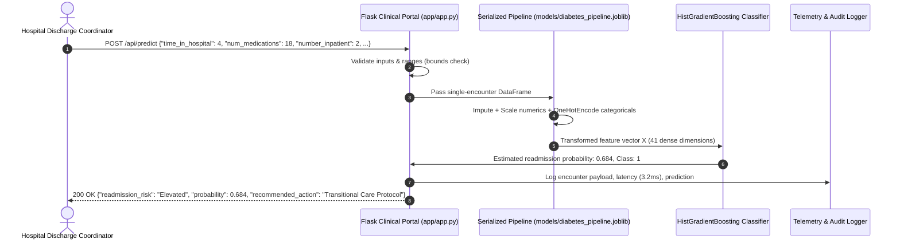
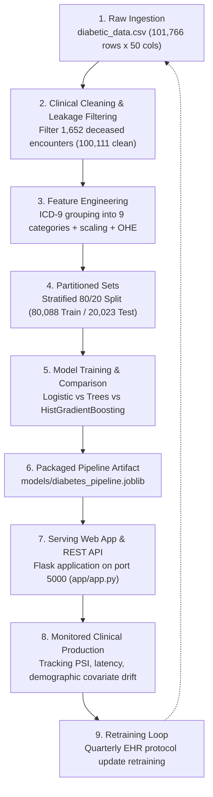
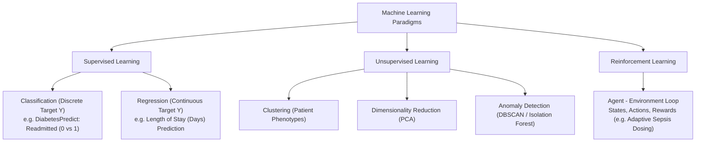

# Module 1: DiabetesPredict as a System — The ML Lifecycle

---

## 1.1 The Day-One Perspective: The Prediction Service as an Operational System

In production clinical machine learning, a model does not exist as an isolated Jupyter notebook calculation. It operates as an active, integrated clinical decision-support microservice within hospital informatics.

On Day One, clinicians and hospital care coordinators interact with **DiabetesPredict** exclusively through an external interface: an HTTP endpoint or clinical web dashboard. They input patient encounter attributes and immediately receive an estimated readmission risk and risk stratification before any internal algorithm architecture is revealed.



### Issuing Requests Against the Running Service
The service can be tested directly from the command line using standard HTTP requests:

```bash
curl -X POST "http://localhost:5000/api/predict" \
     -H "Content-Type: application/json" \
     -d '{
       "time_in_hospital": 6,
       "num_lab_procedures": 52,
       "num_procedures": 2,
       "num_medications": 21,
       "number_outpatient": 1,
       "number_emergency": 0,
       "number_inpatient": 2,
       "number_diagnoses": 9,
       "gender": "Female",
       "age": "[60-70)",
       "admission_type": "Emergency",
       "admission_source": "Emergency Room",
       "primary_diagnosis": "Circulatory",
       "diabetes_diagnosed": "Yes",
       "max_glu_serum": "None",
       "A1Cresult": ">8",
       "insulin": "Up",
       "metformin": "Steady",
       "glipizide": "No",
       "glyburide": "No",
       "change": "Ch",
       "diabetesMed": "Yes"
     }'
```

**JSON Service Response**:
```json
{
  "status": "success",
  "data": {
    "prediction": 1,
    "readmission_risk": "Elevated Risk of Readmission",
    "readmission_probability": 0.6841,
    "context": {
      "admission_type": "Emergency",
      "primary_diagnosis": "Circulatory",
      "prior_inpatient_admissions": 2
    }
  }
}
```

---

## 1.2 The 9-Stage Clinical Machine Learning Lifecycle

The machine learning lifecycle is a closed-loop engineering process consisting of nine distinct phases:



### The 9 Lifecycle Stages in Clinical Context
1. **Raw Data Ingestion**: Extracting patient records, lab test profiles, inpatient medication orders, and hospital encounter logs (`diabetic_data.csv`, 101,766 records across 130 US hospitals from 1999–2008).
2. **Clinical Cleaning & Leakage Filtering**: Filtering encounters where the patient expired in-hospital (`discharge_disposition_id` in 11, 19, 20, 21), dropping transaction IDs (`encounter_id`, `patient_nbr`), and stripping high-missingness columns (`weight` with 96.86% missing).
3. **Feature Engineering**: Grouping raw ICD-9 codes into 9 high-level clinical categories (`Circulatory`, `Respiratory`, `Diabetes`, etc.); scaling numerical variables; encoding categorical variables.
4. **Partitioned Datasets**: Strictly partitioning data into training and hold-out test sets *before* learning transformations (stratified 80/20 partition: 80,088 train / 20,023 test).
5. **Model Training & Comparison**: Optimizing parameters ($\mathbf{w}, b$) on training folds, tuning hyperparameters on validation folds, and benchmarking candidate estimators (`LogisticRegression`, `DecisionTreeClassifier`, `RandomForestClassifier`, `HistGradientBoostingClassifier`).
6. **Packaged Artifact**: Serializing the unified `ColumnTransformer` and trained estimator into a single reproducible file (`models/diabetes_pipeline.joblib`) with metadata.
7. **Served Endpoint**: Deploying the artifact in a lightweight web application (`app/app.py`) exposing web forms and REST API endpoints.
8. **Monitored Clinical Production**: Tracking inference latency, prediction risk distributions, and demographic feature drift (covariate shift) against baseline training profiles.
9. **Retraining Loop**: Automatically or periodically updating the pipeline when hospital guidelines, EHR codes, or formularies change.

---

## 1.3 Mapping Lifecycle Stages to Repository Code

The `diabetes data project` codebase isolates each stage into modular, runnable modules:

| Lifecycle Stage | Code Location | Technology / Tooling |
| :--- | :--- | :--- |
| **Ingestion** | [`ingestion/ingest.py`](file:///c:/Users/Administrator/Desktop/diabetes%20data%20project/ingestion/ingest.py) | Pandas, CSV ingestion, shape validation |
| **Clinical Cleaning** | [`cleaning/run_cleaning.py`](file:///c:/Users/Administrator/Desktop/diabetes%20data%20project/cleaning/run_cleaning.py) | Data hygiene, leakage filtering, zero-variance drops |
| **Exploratory Analysis (EDA)** | [`eda/run_eda.py`](file:///c:/Users/Administrator/Desktop/diabetes%20data%20project/eda/run_eda.py) | Matplotlib, Seaborn, demographic correlations |
| **Categorical Encoding** | [`encoding/run_encoding.py`](file:///c:/Users/Administrator/Desktop/diabetes%20data%20project/encoding/run_encoding.py) | Scikit-Learn `OneHotEncoder`, `OrdinalEncoder` |
| **Feature Scaling** | [`scaling/run_scaling.py`](file:///c:/Users/Administrator/Desktop/diabetes%20data%20project/scaling/run_scaling.py) | Scikit-Learn `StandardScaler`, `MinMaxScaler` |
| **Dataset Partitioning** | [`split/run_split.py`](file:///c:/Users/Administrator/Desktop/diabetes%20data%20project/split/run_split.py) | Scikit-Learn `train_test_split` (stratified) |
| **Linear Model Training** | [`logistic_regression/run_logistic_regression.py`](file:///c:/Users/Administrator/Desktop/diabetes%20data%20project/logistic_regression/run_logistic_regression.py) | `LogisticRegression`, ROC curve plotting |
| **Regularization Analysis** | [`regularization/run_regularization.py`](file:///c:/Users/Administrator/Desktop/diabetes%20data%20project/regularization/run_regularization.py) | L1 (Lasso) vs L2 (Ridge) over $C \in [0.001, 10.0]$ |
| **Feature Attribution** | [`coefficients/run_coefficients.py`](file:///c:/Users/Administrator/Desktop/diabetes%20data%20project/coefficients/run_coefficients.py) | Clinical Odds Ratios ($e^{\beta}$) calculation |
| **Tree Classifiers** | [`decision_tree/run_decision_tree.py`](file:///c:/Users/Administrator/Desktop/diabetes%20data%20project/decision_tree/run_decision_tree.py) | `DecisionTreeClassifier` depth progression |
| **Splitting Criteria** | [`splitting_criteria/run_splitting_criteria.py`](file:///c:/Users/Administrator/Desktop/diabetes%20data%20project/splitting_criteria/run_splitting_criteria.py) | Gini Impurity vs Shannon Entropy comparison |
| **Bias-Variance Curves** | [`bias_variance/run_bias_variance.py`](file:///c:/Users/Administrator/Desktop/diabetes%20data%20project/bias_variance/run_bias_variance.py) | Learning curves over training fractions |
| **Model Benchmarking** | [`model_comparison/run_model_comparison.py`](file:///c:/Users/Administrator/Desktop/diabetes%20data%20project/model_comparison/run_model_comparison.py) | Multi-algorithm evaluation bar charts |
| **Pipeline Packaging** | [`pipeline/run_pipeline.py`](file:///c:/Users/Administrator/Desktop/diabetes%20data%20project/pipeline/run_pipeline.py) | `ColumnTransformer` + `HistGradientBoosting` |
| **Web Serving API** | [`app/app.py`](file:///c:/Users/Administrator/Desktop/diabetes%20data%20project/app/app.py) | Flask web framework, Jinja2 templates, REST API |
| **Automated Testing** | [`tests/test_api.py`](file:///c:/Users/Administrator/Desktop/diabetes%20data%20project/tests/test_api.py), [`test_pipeline.py`](file:///c:/Users/Administrator/Desktop/diabetes%20data%20project/tests/test_pipeline.py) | Python `unittest` suite |

---

## 1.4 The Learning Paradigms Taxonomy

Machine learning divides into three core paradigms:



### What DiabetesPredict Is and Is Not
* **What it IS**: A **Supervised Binary Classification** task. Each historical patient encounter has an observed binary outcome $y_i \in \{0, 1\}$ denoting whether the patient experienced subsequent hospital readmission ($y=1$) or was not readmitted ($y=0$).
* **What it is NOT**:
  - It is **not** Unsupervised Learning: We do not seek unguided patient clustering; the outcome label is known.
  - It is **not** Reinforcement Learning: There is no exploratory trial-and-error policy adjusting drug dosages in real time.
  - It is **not** pure 30-Day Readmission Prediction: Both readmissions occurring within 30 days (`<30`) and after 30 days (`>30`) are grouped into Class 1, modeling the risk of *any* subsequent hospital readmission.

---

## 1.5 Tracing One Prediction End-to-End: Online vs. Batch

### Online Prediction (Single Patient Encounter)
1. **HTTP Ingestion**: Client submits a JSON payload to Flask's `POST /api/predict`.
2. **Schema & Range Validation**: [`src/predict.py`](file:///c:/Users/Administrator/Desktop/diabetes%20data%20project/src/predict.py) checks numerical bounds (e.g., $1 \le \text{time\_in\_hospital} \le 14$, $0 \le \text{num\_medications} \le 81$) and falls back to clinically sensible defaults for missing categories.
3. **Pipeline Transformation**: The single-row DataFrame is passed into `diabetes_pipeline.joblib`. The pipeline's `ColumnTransformer` standardizes numerical features with precomputed means and standard deviations, and one-hot encodes categorical values.
4. **Model Inference**: `HistGradientBoostingClassifier` evaluates decision trees, computing positive class probability $P(Y=1 \mid \mathbf{x})$.
5. **Clinical Stratification**: The service compares probability against threshold $\tau = 0.5$, assigning risk class (`"Elevated Risk"` vs `"Baseline"`).
6. **Response Generation**: The service returns a JSON payload including risk level, predicted probability, and clinical context.

### Batch Prediction (Hospital Cohort Scoring)
When scoring an entire hospital discharge cohort of 2,000 patients overnight:
* Encounter records are read directly from EHR tables or Parquet files.
* Data is passed as a large matrix to `pipeline.predict_proba(X_batch)`.
* Matrix operations run vectorized across CPU cores, bypassing HTTP network overhead to score thousands of records in milliseconds.

---

## 1.6 The Training-Serving Boundary & Clinical Skew

The most common failure mode in production ML is **Training-Serving Skew**: any discrepancy between the feature values, schema, or preprocessing logic used during training and those present at serving.

### The Clinical Data Leakage Trap (Disposition Filtering)
The raw dataset contains 1,652 encounters where the patient expired in-hospital (`discharge_disposition_id` in `[11, 19, 20, 21]`).
* **Why this creates clinical leakage**: A deceased patient cannot be readmitted. In the raw dataset, 100% of expired patients have `readmitted = NO`.
* Retaining them causes the model to learn that extreme severity indicators (which correlate with in-hospital mortality) predict *lower* readmission risk.
* **Mitigation**: Strictly filter expired encounters during initial data preparation before splitting.

### Preventing Code Divergence Skew
In [`src/preprocessing.py`](file:///c:/Users/Administrator/Desktop/diabetes%20data%20project/src/preprocessing.py), feature engineering is encapsulated in a Scikit-Learn `ColumnTransformer`:

```python
preprocessor = ColumnTransformer(
    transformers=[
        ('num', StandardScaler(), NUMERIC_FEATURES),
        ('cat', OneHotEncoder(handle_unknown='ignore', sparse_output=False), CATEGORICAL_FEATURES)
    ]
)
pipeline = Pipeline([
    ('preprocessor', preprocessor),
    ('classifier', estimator)
])
```

Because `diabetes_pipeline.joblib` packages both the fitted transformers and the estimator into a single immutable artifact, the Flask serving app executes the exact same transformation logic as offline training, eliminating training-serving skew.

---

## 1.7 Downstream Course Positioning

| Course Code | Name | Responsibilities & Boundaries |
| :--- | :--- | :--- |
| **CFAI** | Computational Foundations of AI | Linear algebra, multivariable calculus, probability foundations. |
| **This Course** | **Classical ML & ML Engineering** | **Tabular EHR data, convex optimization, linear classifiers, tree ensembles, clustering, calibration, validation discipline, Flask/FastAPI serving, drift monitoring.** |
| **DLAC** | Deep Learning & Architectures | Deep architectures for unstructured clinical data (chest X-rays, pathology slides, raw ICU waveforms). |
| **GALE** | Generative AI & Latent Models | Synthetic clinical record generation, latent diffusion models. |
| **NLPL** | Clinical NLP & LLMs | Clinical notes comprehension, discharge summary extraction, biomedical tokenization, medical LLM fine-tuning. |
| **SDSR** | Systems & Distributed Scale | Multi-hospital federated learning, enterprise feature stores, high-throughput EHR streaming. |

---
