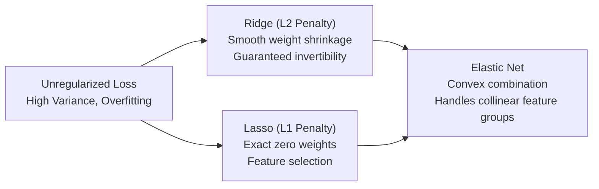

# Module 2: Supervised Learning — Linear Models at Depth

---

## 2.1 Linear Regression Revisited: Normal Equations vs. Gradient Descent

Linear regression models a continuous target $y \in \mathbb{R}$ as a linear combination of input features $\mathbf{x} = [x_1, \dots, x_d]^T \in \mathbb{R}^d$:

$$\hat{y} = \mathbf{w}^T \mathbf{x} + b = \sum_{j=1}^d w_j x_j + b$$

Including an intercept column of ones in design matrix $\mathbf{X} \in \mathbb{R}^{n \times (d+1)}$:

$$\hat{\mathbf{y}} = \mathbf{X} \boldsymbol{\theta}, \quad \text{where } \boldsymbol{\theta} = [b, w_1, \dots, w_d]^T$$

The objective is minimizing the **Ordinary Least Squares (OLS)** Mean Squared Error:

$$J(\boldsymbol{\theta}) = \frac{1}{2n} \|\mathbf{X} \boldsymbol{\theta} - \mathbf{y}\|_2^2 = \frac{1}{2n} (\mathbf{X} \boldsymbol{\theta} - \mathbf{y})^T (\mathbf{X} \boldsymbol{\theta} - \mathbf{y})$$

### Closed-Form Solution: The Normal Equations
Setting the gradient with respect to $\boldsymbol{\theta}$ to zero:

$$\nabla_{\boldsymbol{\theta}} J(\boldsymbol{\theta}) = \frac{1}{n} \mathbf{X}^T (\mathbf{X} \boldsymbol{\theta} - \mathbf{y}) = \mathbf{0} \implies \mathbf{X}^T \mathbf{X} \boldsymbol{\theta} = \mathbf{X}^T \mathbf{y}$$

$$\boldsymbol{\theta}^* = (\mathbf{X}^T \mathbf{X})^{-1} \mathbf{X}^T \mathbf{y}$$

### Iterative Optimization: Gradient Descent
When feature dimension $d$ is large or $\mathbf{X}^T \mathbf{X}$ is ill-conditioned:

$$\boldsymbol{\theta}^{(t+1)} = \boldsymbol{\theta}^{(t)} - \alpha \nabla_{\boldsymbol{\theta}} J(\boldsymbol{\theta}^{(t)}) = \boldsymbol{\theta}^{(t)} - \frac{\alpha}{n} \mathbf{X}^T (\mathbf{X} \boldsymbol{\theta}^{(t)} - \mathbf{y})$$

### Comparative Tradeoffs
| Dimension | Normal Equations | Gradient Descent |
| :--- | :--- | :--- |
| **Computational Complexity** | $\mathcal{O}(d^3) + \mathcal{O}(n d^2)$ due to matrix inversion | $\mathcal{O}(k \cdot n \cdot d)$ for $k$ iterations |
| **Feature Scalability ($d$)** | Infeasible when $d > 10^4$ | Scales efficiently to millions of features |
| **Hyperparameters** | None (parameter-free analytic solution) | Requires tuning learning rate $\alpha$ and iterations |
| **Feature Scaling** | Not mathematically required | Strictly mandatory to avoid elongated loss surfaces |
| **Collinear Columns** | Fails if $\mathbf{X}^T \mathbf{X}$ is rank-deficient | Converges to a valid local minimum |

---

## 2.2 Regularization: Ridge ($L_2$), Lasso ($L_1$), and Elastic Net

When features exhibit collinearity (e.g., `number_inpatient` and `number_emergency`), unregularized least squares yields unstable, high-variance parameter estimates. Regularization constrains coefficient magnitudes.



### 1. Ridge Regression ($L_2$ Regularization)
Minimizes empirical error penalized by squared Euclidean parameter norm:

$$J_{\text{Ridge}}(\mathbf{w}) = \frac{1}{2n} \|\mathbf{y} - \mathbf{X}\mathbf{w}\|_2^2 + \frac{\lambda}{2} \|\mathbf{w}\|_2^2 = \frac{1}{2n} \|\mathbf{y} - \mathbf{X}\mathbf{w}\|_2^2 + \frac{\lambda}{2} \sum_{j=1}^d w_j^2$$

Setting the gradient to zero yields the closed form:

$$\mathbf{w}_{\text{Ridge}} = (\mathbf{X}^T \mathbf{X} + \lambda \mathbf{I})^{-1} \mathbf{X}^T \mathbf{y}$$

> [!NOTE]
> Even if $\mathbf{X}^T \mathbf{X}$ is singular (non-invertible due to perfect collinearity), the matrix $(\mathbf{X}^T \mathbf{X} + \lambda \mathbf{I})$ is strictly positive-definite and invertible for any $\lambda > 0$.

### 2. Lasso Regression ($L_1$ Regularization)
Minimizes empirical error penalized by Manhattan parameter norm:

$$J_{\text{Lasso}}(\mathbf{w}) = \frac{1}{2n} \|\mathbf{y} - \mathbf{X}\mathbf{w}\|_2^2 + \lambda \|\mathbf{w}\|_1 = \frac{1}{2n} \|\mathbf{y} - \mathbf{X}\mathbf{w}\|_2^2 + \lambda \sum_{j=1}^d |w_j|$$

Because $|w_j|$ has a non-differentiable cusp at $w_j = 0$, it has no closed-form matrix solution. It is optimized via **Coordinate Descent** using the **Soft-Thresholding Operator**:

$$S(z, \gamma) = \text{sign}(z) \max(|z| - \gamma, 0)$$

$$w_j^* = S\left(\frac{1}{n} \mathbf{x}_j^T (\mathbf{y} - \mathbf{X}_{-j}\mathbf{w}_{-j}), \lambda\right)$$

### 3. Elastic Net
A convex combination of $L_1$ and $L_2$ penalties parameterized by mixing ratio $r \in [0, 1]$:

$$J_{\text{ElasticNet}}(\mathbf{w}) = \frac{1}{2n} \|\mathbf{y} - \mathbf{X}\mathbf{w}\|_2^2 + \lambda \left[ r \|\mathbf{w}\|_1 + \frac{1-r}{2} \|\mathbf{w}\|_2^2 \right]$$

Lasso arbitrarily picks one feature from a group of correlated predictors and sets the rest to zero; Elastic Net creates a **grouping effect**, selecting or shrinking correlated variables together.

---

## 2.3 The Geometric Picture of Sparsity

Consider the constrained optimization formulations where empirical loss is minimized subject to a penalty budget:

* **Ridge ($L_2$) constraint**: $w_1^2 + w_2^2 \le C$ (a circular disk / sphere).
* **Lasso ($L_1$) constraint**: $|w_1| + |w_2| \le C$ (a diamond / rhombus).

The contours of the quadratic loss function form ellipses centered at the unconstrained OLS estimator $\hat{\mathbf{w}}_{\text{OLS}}$. The constrained optimum occurs at the first point where the expanding loss ellipse touches the constraint region:

```
          L1 (Lasso) Constraint               L2 (Ridge) Constraint
                 w2                                  w2
                  ▲                                   ▲
                  │                                   │
                ┌─┴─┐                               ┌───┐
               ╱  │  ╲                            ╱   │   ╲
              ╱   │   ╲                          │    │    │
   ──────────◆────┼────◆────────► w1     ────────┼────┼────┼────────► w1
              ╲   │   ╱                          │    │    │
               ╲  │  ╱                            ╲   │   ╱
                └─┬─┘                               └───┘
                  │                                   │
      * Tangency occurs on axis              * Tangency occurs anywhere
      * One coordinate is EXACTLY 0           * Coordinates shrink towards 0
      * Induces sparse solutions              * Keeps all features active
```

Because the diamond constraint boundary has sharp corners located directly on the coordinate axes ($w_1 = 0$ or $w_2 = 0$), expanding elliptical loss contours are geometrically much more likely to hit a sharp vertex than a flat edge. At a vertex, one or more parameters are **identically zero**, producing automatic feature selection. The smooth, curved $L_2$ sphere has no corners, so tangency occurs off-axis, shrinking weights toward zero without setting them exactly to zero.

---

## 2.4 Logistic Regression for Binary Classification

Logistic regression maps linear combinations of features to probabilities bounded in $[0, 1]$ using the **sigmoid (logistic) link function**:

$$\sigma(z) = \frac{1}{1 + e^{-z}} = \frac{e^z}{1 + e^z}$$

$$P(\text{Readmitted} = 1 \mid \mathbf{x}) = \sigma(\mathbf{w}^T \mathbf{x} + b) = \frac{1}{1 + e^{-(\mathbf{w}^T \mathbf{x} + b)}}$$

### Odds and Log-Odds (The Logit)
The odds ratio represents the ratio of probability of occurrence to non-occurrence:

$$\text{Odds} = \frac{p}{1 - p} = \frac{\frac{1}{1 + e^{-z}}}{1 - \frac{1}{1 + e^{-z}}} = \frac{\frac{1}{1 + e^{-z}}}{\frac{e^{-z}}{1 + e^{-z}}} = \frac{1}{e^{-z}} = e^z = e^{\mathbf{w}^T \mathbf{x} + b}$$

Taking the natural logarithm yields the **logit function**:

$$\text{logit}(p) = \ln\left(\frac{p}{1 - p}\right) = \mathbf{w}^T \mathbf{x} + b$$

The log-odds of hospital readmission are strictly linear in the input features.

### The Binary Cross-Entropy Loss (Log-Loss)
For labels $y_i \in \{0, 1\}$ and predicted probabilities $p_i = \sigma(\mathbf{w}^T \mathbf{x}_i + b)$:

$$\mathcal{L}(\mathbf{w}, b) = -\frac{1}{n} \sum_{i=1}^n \left[ y_i \ln(p_i) + (1 - y_i) \ln(1 - p_i) \right]$$

### Gradient Derivation
Note that the derivative of the sigmoid function is $\sigma'(z) = \sigma(z)(1 - \sigma(z))$.

$$\frac{\partial \mathcal{L}}{\partial \mathbf{w}} = \frac{1}{n} \sum_{i=1}^n (\sigma(\mathbf{w}^T \mathbf{x}_i + b) - y_i) \mathbf{x}_i = \frac{1}{n} \mathbf{X}^T (\mathbf{p} - \mathbf{y})$$

The gradient has the exact same structural form as linear regression, but residual errors $(\mathbf{p} - \mathbf{y})$ are computed using probabilities rather than linear continuous outputs.

### The Decision Boundary as a Hyperplane
Classification assigns $\hat{y} = 1$ when $P(Y=1|\mathbf{x}) \ge \tau$ (default threshold $\tau = 0.5$):

$$P(Y=1|\mathbf{x}) \ge 0.5 \iff \mathbf{w}^T \mathbf{x} + b \ge 0$$

The decision boundary is the affine hyperplane:

$$\{\mathbf{x} \in \mathbb{R}^d \mid \mathbf{w}^T \mathbf{x} + b = 0\}$$

---

## 2.5 Multinomial Logistic Regression (Softmax Regression)

When classifying across $K > 2$ clinical categories (e.g., predicting 3-tier readmission: `NO`, `>30`, `<30`), the sigmoid generalizes to the **Softmax function**:

$$P(Y = k \mid \mathbf{x}) = \frac{e^{\mathbf{w}_k^T \mathbf{x} + b_k}}{\sum_{j=1}^K e^{\mathbf{w}_j^T \mathbf{x} + b_j}}$$

The loss function is the **Categorical Cross-Entropy**:

$$\mathcal{L}_{\text{multi}} = -\frac{1}{n} \sum_{i=1}^n \sum_{k=1}^K \mathbb{I}(y_i = k) \ln\left( P(Y = k \mid \mathbf{x}_i) \right)$$

Because probabilities sum to 1 ($\sum_{k=1}^K P(Y=k|\mathbf{x}) = 1$), parameters are overdetermined. In practice, either a reference baseline class is set to zero ($\mathbf{w}_1 = \mathbf{0}, b_1 = 0$), or symmetric $L_2$ regularization is applied across all weight vectors.

---

## 2.6 Feature Scaling and Standardization in Clinical Data

Feature transformations modify the numerical scale and distribution of continuous inputs:

$$\text{StandardScaler (Z-Score)}: \quad z = \frac{x - \mu}{\sigma}$$

$$\text{MinMaxScaler}: \quad x_{\text{norm}} = \frac{x - x_{\min}}{x_{\max} - x_{\min}}$$

### When Scaling Matters vs. When It Does Not
* **Mandatory (Gradient Descent & Linear Models)**: 
  - Without scaling, features with large numeric ranges (e.g., `num_lab_procedures` from 1 to 132) dominate gradient updates over features with small ranges (e.g., `number_inpatient` from 0 to 21). Gradient descent oscillates orthogonally, slowing convergence.
  - In Ridge/Lasso regularization, the penalty $\lambda \sum w_j^2$ penalizes all weights equally. An unscaled feature with small magnitude requires a large weight $w_j$ to affect prediction, subjecting it to disproportionate penalty shrinkage.
* **Completely Irrelevant (Tree-Based Models)**:
  - Decision trees, Random Forests, and Gradient Boosted Trees evaluate candidate split thresholds monotonically feature-by-feature ($x_j \le \theta$). Any strictly monotonic transformation preserving order leaves split decisions unchanged.

---

## 2.7 Categorical Encodings in Clinical Data

| Encoding Technique | Mechanism | Ideal Use Case | Pitfalls |
| :--- | :--- | :--- | :--- |
| **One-Hot Encoding** | Creates $K$ binary columns. | Low-cardinality nominal features (`admission_type`, `gender`). | High dimensionality if cardinality is high. |
| **Ordinal Encoding** | Maps categories to integers ($0, 1, 2, \dots$). | Naturally ordered categories (`age` brackets: `[0-10)` < `[10-20)`). | Imposes false metric distance if applied to nominal diagnoses. |
| **Target Encoding** | Replaces category with mean target $E[Y\|X=c]$. | High-cardinality features (e.g., hospital ID, zip code). | Severe target leakage without out-of-fold computation. |

In the diabetes pipeline, nominal categories (`primary_diagnosis`, `admission_type`, `admission_source`, medications) are encoded using `OneHotEncoder(handle_unknown='ignore', sparse_output=False)` to prevent imposing artificial numeric distances between clinical diagnoses.

---

## 2.8 Handling Missing Values

Missing data is categorized into three mechanisms:
1. **MCAR (Missing Completely at Random)**: Missingness is independent of observed and unobserved data.
2. **MAR (Missing at Random)**: Missingness depends on observed features; conditional imputation is unbiased.
3. **MNAR (Missing Not at Random)**: Missingness depends on the unobserved value itself.

### Clinical Negatives: Lab Tests
In the diabetes dataset, missing values in `max_glu_serum` and `A1Cresult` are not treated as data dropouts; they are explicitly categorized as `'None'`. Clinically, this denotes **"test not ordered by physician"**, which is an informative clinical negative indicator of mild acute presentation.

---

## 2.9 Worked Clinical Example: Odds Ratios on Readmission Data

From [`coefficients/run_coefficients.py`](file:///c:/Users/Administrator/Desktop/diabetes%20data%20project/coefficients/run_coefficients.py), exponentiating the standardized logistic regression coefficient gives the **Odds Ratio (OR)**:

$$\text{Odds Ratio}_j = \exp(w_j)$$

```python
# Standalone execution snippet
import numpy as np
import pandas as pd
from sklearn.linear_model import LogisticRegression

# Fitted on standardized clinical features
clf = LogisticRegression(penalty="l2", C=1.0, solver="lbfgs")
# Feature odds ratios:
# number_inpatient:   w = +0.3421 -> OR = exp(0.3421) = 1.408 (+40.8% readmission odds)
# number_emergency:   w = +0.0984 -> OR = exp(0.0984) = 1.103 (+10.3% readmission odds)
# number_diagnoses:   w = +0.0892 -> OR = exp(0.0892) = 1.093 (+9.3% readmission odds)
# time_in_hospital:   w = +0.0754 -> OR = exp(0.0754) = 1.078 (+7.8% readmission odds)
```

### Clinical Interpretation
* **Prior Inpatient Admissions (`number_inpatient`)**: Each 1-standard-deviation increase ($+1.26$ admissions in preceding 12 months) increases the odds of subsequent hospital readmission by **40.8%** ($\text{OR} = 1.408$), making prior utilization the single strongest readmission risk factor.
* **Multimorbidity (`number_diagnoses`)**: Each additional diagnosis category increases readmission odds by **9.3%**, validating that clinical complexity compounds discharge risk.

---
