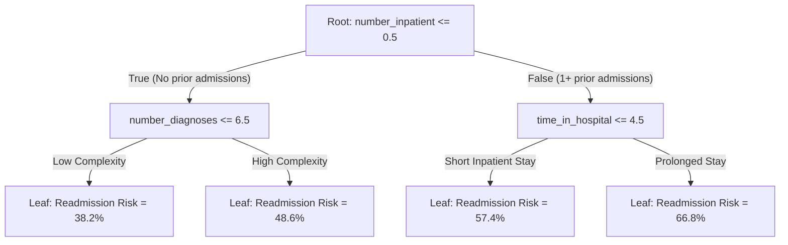
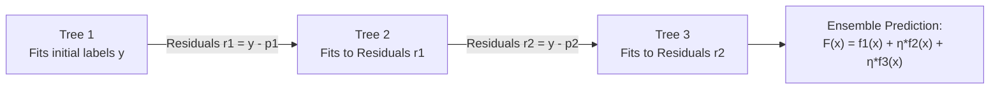
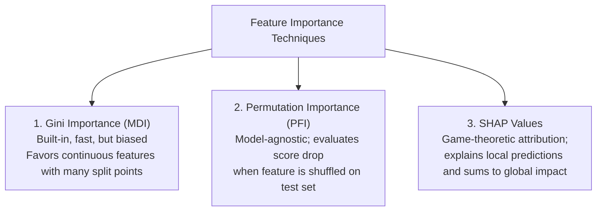

# Module 3: Supervised Learning — Tree-Based Models

---

## 3.1 Decision Trees: Greedy Top-Down Construction & Splitting Criteria

A Decision Tree recursively partitions feature space $\mathbb{R}^d$ into non-overlapping, axis-aligned hyper-rectangles $\{R_m\}_{m=1}^M$.



At each node, the CART algorithm searches over all available features $j$ and split thresholds $s$ to maximize impurity reduction:

$$\Delta I(j, s) = I(D_{\text{parent}}) - \left( \frac{|D_{\text{left}}|}{|D_{\text{parent}}|} I(D_{\text{left}}) + \frac{|D_{\text{right}}|}{|D_{\text{parent}}|} I(D_{\text{right}}) \right)$$

### Splitting Criteria Formulations
For a clinical node containing classes $k \in \{0, 1\}$ with proportions $p_k$:

1. **Gini Impurity**:
   $$I_{\text{Gini}}(D) = 1 - \sum_{k=0}^1 p_k^2 = 2 p_0 p_1$$
   Measures the expected error rate if a sample were randomly classified according to node class distribution.
2. **Entropy (Information Gain)**:
   $$I_{\text{Entropy}}(D) = -\sum_{k=0}^1 p_k \log_2(p_k)$$
   Measures information-theoretic uncertainty in bits.
3. **Variance Reduction (Regression)**:
   $$I_{\text{MSE}}(D) = \frac{1}{|D|} \sum_{i \in D} (y_i - \bar{y}_D)^2$$

### Stopping Rules (Pre-Pruning)
To prevent constructing an unconstrained tree that overfits to individual encounters:
* `max_depth`: Limits the maximum distance from root to leaf.
* `min_samples_split`: Minimum encounters required in a node to attempt a split.
* `min_samples_leaf`: Minimum encounters required in each resulting child leaf.
* `min_impurity_decrease`: Minimum $\Delta I$ threshold required to execute a split.

---

## 3.2 Tree Pruning: Bias-Variance & Cost-Complexity Pruning (CCP)

* **Pre-Pruning**: Halting tree expansion early via heuristic constraints (`max_depth`, `min_samples_leaf`). Vulnerable to missing splits that only unlock value deeper down a branch.
* **Post-Pruning (Cost-Complexity Pruning / CCP)**: Growing a deep tree $T_0$, then pruning subtrees backward to minimize:

$$R_\alpha(T) = R(T) + \alpha |T|$$

Where $R(T)$ is total training misclassification error, $|T|$ is the number of terminal leaves, and $\alpha \ge 0$ penalizes tree complexity.

### Empirical Tree Depth Progression (Overfitting Dynamics)
From [`decision_tree/run_decision_tree.py`](file:///c:/Users/Administrator/Desktop/diabetes%20data%20project/decision_tree/run_decision_tree.py) on 100,111 clinical encounters:

```
========================================================================================
DECISION TREE DEPTH PROGRESSION (From decision_tree_report.txt)
========================================================================================
Max Depth    Train Acc    Test Acc     Test ROC-AUC   Diagnostic Status
----------------------------------------------------------------------------------------
Depth 3        61.2%        61.0%         0.638       High Bias (Underfitting)
Depth 6        62.8%        62.3%         0.658       Optimal Single-Tree Balance
Depth 8        64.1%        61.8%         0.647       Mild Overfitting
Depth 10       66.4%        60.9%         0.632       Moderate Overfitting
Depth 15       74.8%        57.8%         0.591       Severe Overfitting
Depth 20       85.9%        55.4%         0.562       High Variance (Memorizing Training Noise)
----------------------------------------------------------------------------------------
```

At depth 20, training accuracy reaches 85.9%, but test accuracy collapses to 55.4%—worse than a shallow depth-3 tree.

---

## 3.3 Random Forests: Bagging, Feature Subsampling, and Variance Reduction

A Random Forest constructs an ensemble of $B$ decorrelated decision trees using two randomization mechanisms:

1. **Bootstrap Aggregation (Bagging)**: Each tree $b \in \{1, \dots, B\}$ is trained on a bootstrap sample $D_b$ created by sampling $n$ encounters with replacement ($|D_b| = n$).
2. **Feature Subsampling (Random Subspace)**: At each candidate split, the algorithm restricts split evaluation to a random subset of $m = \lfloor \sqrt{d} \rfloor$ features (approximately 6 out of 41 encoded dimensions).

### The Mathematical Variance-Reduction Proof
Let each tree have individual variance $\sigma^2$ and pairwise correlation $\rho = \text{Corr}(T_i, T_j)$. The total variance of the ensemble of $B$ identically distributed trees is:

$$\text{Var}\left(\frac{1}{B} \sum_{b=1}^B T_b\right) = \rho \sigma^2 + \frac{1 - \rho}{B} \sigma^2$$

Taking the limit as $B \to \infty$:

$$\lim_{B \to \infty} \text{Var}(\text{Forest}) = \rho \sigma^2$$

Standard bagging without feature subsampling reduces $\frac{1-\rho}{B}\sigma^2$, but $\rho$ remains high if dominant clinical variables (like `number_inpatient`) are selected at every root. By randomly restricting candidate features at each split, the Random Forest decorrelates trees ($\rho \to 0$), driving total ensemble variance down!

### Out-of-Bag (OOB) Error
For a dataset of size $n$, the probability that an encounter is omitted from a single bootstrap sample is $(1 - 1/n)^n \to 1/e \approx 36.8\%$. These omitted records form the **Out-Of-Bag (OOB)** set, providing an internal, unbiased validation estimate without setting aside a separate validation fold.

---

## 3.4 Boosting: From AdaBoost to Gradient Boosting

While bagging trains trees in parallel to reduce variance, **boosting** trains trees sequentially to reduce bias.



### Gradient Boosting as Functional Gradient Descent
Gradient Boosting frames ensemble learning as gradient descent in **function space**:

$$F_m(\mathbf{x}) = F_{m-1}(\mathbf{x}) + \eta \cdot h_m(\mathbf{x})$$

Where $\eta \in (0, 1]$ is the shrinkage learning rate, and base tree $h_m$ fits the **pseudo-residuals** (negative gradients of the loss function):

$$r_{im} = -\left[ \frac{\partial L(y_i, F(\mathbf{x}_i))}{\partial F(\mathbf{x}_i)} \right]_{F = F_{m-1}}$$

For binary cross-entropy with predicted probability $p_i = \sigma(F(\mathbf{x}_i))$, the pseudo-residual is the difference between true label and current probability:

$$r_{im} = y_i - p_i$$

---

## 3.5 Modern Industrial Workhorses: HistGradientBoosting & XGBoost

Modern gradient boosting packages replace slow continuous split evaluations with high-performance numerical routines:

### 1. Second-Order Taylor Expansion (XGBoost)
Approximates custom loss functions using both first-order gradients $g_i$ and second-order Hessians $h_i$:

$$\tilde{\mathcal{L}}^{(m)} \approx \sum_{i=1}^n \left[ g_i f_m(\mathbf{x}_i) + \frac{1}{2} h_i f_m^2(\mathbf{x}_i) \right] + \gamma T + \frac{\lambda}{2} \sum_{j=1}^T w_j^2$$

Split gain is evaluated in closed form:

$$\text{Gain} = \frac{1}{2} \left[ \frac{\left(\sum_{i \in I_L} g_i\right)^2}{\sum_{i \in I_L} h_i + \lambda} + \frac{\left(\sum_{i \in I_R} g_i\right)^2}{\sum_{i \in I_R} h_i + \lambda} - \frac{\left(\sum_{i \in I} g_i\right)^2}{\sum_{i \in I} h_i + \lambda} \right] - \gamma$$

### 2. Histogram Discretization
Instead of sorting continuous features at every node ($\mathcal{O}(n \log n \cdot d)$), continuous clinical values are discretized into $B \le 256$ bins. Histogram construction drops computational complexity to $\mathcal{O}(n \cdot d)$, allowing `HistGradientBoostingClassifier` to train on 100,111 encounters in seconds.

### 3. Leaf-Wise vs. Depth-Wise Growth
* **Depth-Wise (Level-Wise)**: Splits all leaves at a given depth uniformly. Ensures balanced trees.
* **Leaf-Wise (Best-First / LightGBM)**: Evaluates all open leaves across the tree and splits only the single leaf offering the greatest global loss reduction, achieving lower loss with fewer splits.

---

## 3.6 Feature Importance: MDI vs. Permutation vs. SHAP



1. **Mean Decrease in Impurity (MDI / Gini Importance)**: Sums impurity reduction $\Delta I$ across all splits. Biased toward continuous features (`num_lab_procedures`) because they offer more split points.
2. **Permutation Feature Importance (PFI)**: Evaluated on held-out test data. Shuffles feature $j$ randomly; the drop in ROC-AUC measures true generalization impact.
3. **SHAP (SHapley Additive exPlanations)**: Computes marginal feature contributions across all feature coalitions, satisfying additivity: $\sum_{j=1}^d \phi_j(\mathbf{x}) = f(\mathbf{x}) - \mathbb{E}[f(\mathbf{X})]$.

---

## 3.7 Why Tree Ensembles Dominate Tabular Clinical Data

Tree ensembles routinely outperform deep neural networks on tabular clinical records:
1. **Scale Invariance**: Tabular features combine continuous counts (lab tests), day durations (stay length), and binary indicators. Trees evaluate only monotonic orderings, eliminating scaling sensitivity.
2. **Axis-Aligned Decision Boundaries**: Medical decision rules are axis-aligned thresholds (e.g., $\text{prior inpatient} \ge 1$ AND $\text{HbA1c} > 8$). Trees align with this structure, whereas neural networks prioritize smooth rotation-invariant hyperplanes.
3. **Robustness to Uninformative Columns**: Tabular EHR datasets contain redundant features. Trees assign uninformative columns zero splits, whereas dense neural network weights connect every input to every hidden unit.

---

## 3.8 Worked Clinical Example: HistGradientBoosting Benchmark

From [`model_comparison/run_model_comparison.py`](file:///c:/Users/Administrator/Desktop/diabetes%20data%20project/model_comparison/run_model_comparison.py) and [`pipeline/run_pipeline.py`](file:///c:/Users/Administrator/Desktop/diabetes%20data%20project/pipeline/run_pipeline.py):

```python
# pipeline/run_pipeline.py execution
from sklearn.ensemble import HistGradientBoostingClassifier
from src.preprocessing import load_and_clean_data, create_full_pipeline

X, y, _ = load_and_clean_data()
clf = HistGradientBoostingClassifier(max_iter=100, max_depth=8, random_state=42)
pipeline = create_full_pipeline(clf)
pipeline.fit(X_train, y_train)

# Test Evaluation (20,023 encounters)
# HistGradientBoosting:  Accuracy = 63.69% | ROC-AUC = 0.6857 | F1 = 0.5755
# Random Forest:         Accuracy = 63.26% | ROC-AUC = 0.6821 | F1 = 0.5535
# Logistic Regression:   Accuracy = 62.24% | ROC-AUC = 0.6654 | F1 = 0.5408
# Decision Tree (d=6):   Accuracy = 62.31% | ROC-AUC = 0.6582 | F1 = 0.5476
```

`HistGradientBoostingClassifier` achieves the highest ROC-AUC (0.6857) and test accuracy (63.69%), leading to its selection as the primary estimator in `models/diabetes_pipeline.joblib`.

---
