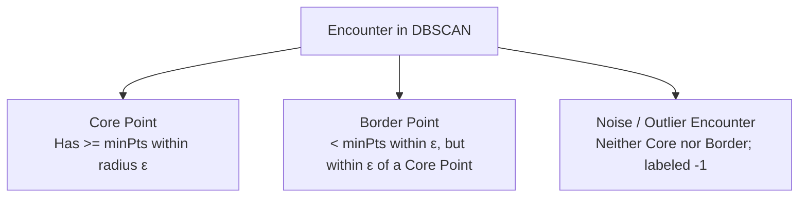

# Module 4: Unsupervised Learning

---

## 4.1 K-Means Clustering: Lloyd's Algorithm, K-Means++, and Evaluation

K-Means partitions an unlabelled dataset $\mathbf{X} = \{\mathbf{x}_1, \dots, \mathbf{x}_n\} \subset \mathbb{R}^d$ into $K$ disjoint clusters $C = \{C_1, \dots, C_K\}$ by minimizing the **Within-Cluster Sum of Squares (WCSS)** or **Inertia**:

$$J(C, \boldsymbol{\mu}) = \sum_{k=1}^K \sum_{\mathbf{x} \in C_k} \|\mathbf{x} - \boldsymbol{\mu}_k\|_2^2$$

### Lloyd's Algorithm
1. **Assignment Step**: Assign each observation to the cluster with the nearest centroid in Euclidean space:
   $$c^{(i)} = \arg\min_{k \in \{1, \dots, K\}} \|\mathbf{x}^{(i)} - \boldsymbol{\mu}_k\|_2^2$$
2. **Update Step**: Recompute cluster centroids as the geometric mean of assigned encounters:
   $$\boldsymbol{\mu}_k = \frac{1}{|C_k|} \sum_{\mathbf{x} \in C_k} \mathbf{x}$$
Lloyd's algorithm monotonically decreases WCSS and is guaranteed to converge to a local minimum.

### K-Means++ Initialization
Standard random initialization often converges to poor local minima if centroids start close together. **K-Means++** guarantees an $\mathcal{O}(\log K)$ competitive bound:
1. Choose the first centroid $\boldsymbol{\mu}_1$ uniformly at random from $\mathbf{X}$.
2. For each remaining encounter $\mathbf{x}$, compute squared Euclidean distance $D(\mathbf{x})^2 = \min_{j} \|\mathbf{x} - \boldsymbol{\mu}_j\|_2^2$ to the nearest chosen centroid.
3. Select the next centroid with probability proportional to squared distance:
   $$P(\mathbf{x}) = \frac{D(\mathbf{x})^2}{\sum_{\mathbf{x}' \in \mathbf{X}} D(\mathbf{x}')^2}$$
4. Repeat steps 2–3 until $K$ centroids are chosen.

### Determining Optimal K: Elbow Method vs. Silhouette Analysis
* **Elbow Method**: Plots Inertia against $K$. Look for the inflection point (elbow) where marginal reduction in WCSS diminishes rapidly.
* **Silhouette Analysis**: Measures how similar encounter $i$ is to its own cluster compared to neighboring clusters:
  $$s(i) = \frac{b(i) - a(i)}{\max(a(i), b(i))}, \quad s(i) \in [-1, +1]$$
  Where $a(i)$ is mean intra-cluster distance and $b(i)$ is mean nearest-cluster distance.
  - $s(i) \approx +1$: Well-clustered and distant from neighbors.
  - $s(i) \approx 0$: Lies directly on the boundary between clusters.
  - $s(i) < 0$: Likely assigned to the wrong cluster.

### Mini-Batch K-Means
For large hospital cohorts, Mini-Batch K-Means samples small random batches ($B \approx 500 \dots 2000$) to update centroids via a running convex combination, reducing memory consumption to $\mathcal{O}(B \cdot d)$ and speeding up convergence by $3\times\text{--}8\times$.

---

## 4.2 Hierarchical Clustering & Dendrograms

Agglomerative hierarchical clustering builds bottom-up cluster hierarchies without requiring a pre-specified $K$:
* Starts with $n$ singleton clusters.
* Sequentially merges the two clusters with minimum pairwise linkage distance until a single cluster remains.

```
       Dendrogram of Clinical Cohorts (Agglomerative Ward's Linkage)
  Variance
     ▲
     │                     ┌─────────────────────────────┐
     │                     │                             │
     │         ┌───────────┴───────────┐                 │
     │         │                       │                 │
     │   ┌─────┴─────┐           ┌─────┴─────┐           │
     │   │ Cohort 1  │ Cohort 2  │ Cohort 3  │ Cohort 4  │
     └───┴───────────┴───────────┴───────────┴───────────┴─── Encounters
```

### Linkage Distance Metrics
1. **Single Linkage**: $d_{\min}(A, B) = \min_{\mathbf{a} \in A, \mathbf{b} \in B} \|\mathbf{a} - \mathbf{b}\|$. Vulnerable to the *chaining effect* (long, straggly clusters connected by single outlier bridges).
2. **Complete Linkage**: $d_{\max}(A, B) = \max_{\mathbf{a} \in A, \mathbf{b} \in B} \|\mathbf{a} - \mathbf{b}\|$. Produces compact, spherical clusters.
3. **Average Linkage**: $d_{\text{avg}}(A, B) = \frac{1}{|A||B|} \sum_{\mathbf{a} \in A} \sum_{\mathbf{b} \in B} \|\mathbf{a} - \mathbf{b}\|$.
4. **Ward's Method**: Minimizes increase in total within-cluster variance upon merging:
   $$\Delta \text{Var} = \frac{|A||B|}{|A| + |B|} \|\boldsymbol{\mu}_A - \boldsymbol{\mu}_B\|_2^2$$

---

## 4.3 Density-Based Clustering: DBSCAN

DBSCAN (Density-Based Spatial Clustering of Applications with Noise) discovers clusters of arbitrary shapes and flags noise points without forcing every encounter into a cluster:



### Core Formulations
* $\boldsymbol{\epsilon}$-Neighborhood: $N_\epsilon(\mathbf{p}) = \{\mathbf{q} \in D \mid \|\mathbf{p} - \mathbf{q}\| \le \epsilon\}$.
* **Core Point**: $|N_\epsilon(\mathbf{p})| \ge \text{minPts}$.
* **Density-Connected**: Two encounters are density-connected if there exists a chain of core points connecting them.
* **Clinical Strength**: Identifies extreme clinical utilization outliers naturally as noise points (`label = -1`) without distorting cluster centroids.

---

## 4.4 Dimensionality Reduction: PCA and Clinical Pitfalls

Principal Component Analysis (PCA) finds an orthogonal basis maximizing the variance of projected clinical encounters:

$$\max_{\mathbf{u}_1} \mathbf{u}_1^T \boldsymbol{\Sigma} \mathbf{u}_1 \quad \text{subject to } \|\mathbf{u}_1\|_2 = 1$$

Where $\boldsymbol{\Sigma} = \frac{1}{n} \mathbf{X}^T \mathbf{X}$ is the sample covariance matrix of standardized features.

### Critical Production Pitfalls
1. **Running PCA Without Standardization**: If `num_lab_procedures` has variance $380$ and `number_inpatient` has variance $1.6$, PCA's first component will align almost entirely with lab procedures, ignoring prior inpatient admissions despite their higher predictive value.
2. **Loss of Clinical Explainability**: Components are linear combinations of all features ($\mathbf{z}_1 = 0.45 \cdot \text{time\_in\_hospital} + 0.38 \cdot \text{num\_medications} - \dots$). Clinical review boards often reject models built on PCA components due to a lack of directly interpretable clinical drivers.

---

## 4.5 Visualisation Workhorses: t-SNE vs. UMAP

| Attribute | t-SNE | UMAP |
| :--- | :--- | :--- |
| **Mathematical Basis** | Minimizes KL divergence between high-dim Gaussian and low-dim Student-t affinities. | Riemannian geometry and fuzzy simplicial sets. |
| **Runtime Speed** | $\mathcal{O}(n^2)$ or $\mathcal{O}(n \log n)$ via Barnes-Hut. | $\mathcal{O}(n \cdot d)$, scales to 100k+ encounters. |
| **Global Structure** | Preserves local neighborhoods; tears global distances apart. | Preserves local neighborhoods while maintaining global topology. |
| **Hyperparameters** | `perplexity` (typically 30–50). | `n_neighbors`, `min_dist`. |

> [!WARNING]
> **Distances in t-SNE and UMAP Projections Are Non-Metric!**
> Do not compute Euclidean distances, cluster sizes, or densities in 2D t-SNE/UMAP projections. Distances between distant clusters do not represent true metric distances in original feature space.

---

## 4.6 Anomaly Detection: Isolation Forest and Beyond

### Isolation Forest
Rather than modeling normal clinical profiles to find deviations, an **Isolation Forest** isolates anomalies directly:
* Ensembles of completely random decision trees partition features uniformly at random.
* Clinical anomalies (e.g., extreme medication counts or rare multimorbidities) reside in sparse regions and require **fewer random splits** to become isolated into single-leaf nodes.

Anomaly score from average path length $E[h(\mathbf{x})]$:

$$s(\mathbf{x}, n) = 2^{-\frac{E[h(\mathbf{x})]}{c(n)}}$$

* Short path length ($E[h(\mathbf{x})] \to 0$) $\implies s \to 1$: Flagged as an **anomaly**.
* Long path length $\implies s \to 0$: Normal central observation.

---

## 4.7 Practical Pipeline: Patient Phenotyping as Supervised Features

Unsupervised clustering discovers latent patient cohorts (e.g., "Acute High-Utilization", "Chronic Outpatient"). Feeding these cluster assignments into a downstream supervised classifier provides high-level phenotypic context that can improve prediction accuracy:

```python
import numpy as np
import pandas as pd
from sklearn.pipeline import Pipeline
from sklearn.preprocessing import StandardScaler
from sklearn.cluster import KMeans
from sklearn.base import BaseEstimator, TransformerMixin
from sklearn.ensemble import HistGradientBoostingClassifier

class PatientClusterEnricher(BaseEstimator, TransformerMixin):
    """Enriches clinical feature vectors with distances to learned patient phenotype centroids."""
    def __init__(self, n_clusters=4, random_state=42):
        self.n_clusters = n_clusters
        self.random_state = random_state
        self.kmeans = KMeans(n_clusters=n_clusters, init="k-means++", n_init=10, random_state=random_state)

    def fit(self, X, y=None):
        self.kmeans.fit(X)
        return self

    def transform(self, X):
        cluster_distances = self.kmeans.transform(X)
        cluster_labels = self.kmeans.predict(X).reshape(-1, 1)
        return np.hstack([X, cluster_distances, cluster_labels])

# Supervised integration pipeline
clinical_pipeline = Pipeline([
    ("scaler", StandardScaler()),
    ("phenotyping", PatientClusterEnricher(n_clusters=4)),
    ("classifier", HistGradientBoostingClassifier(random_state=42))
])
```

---
