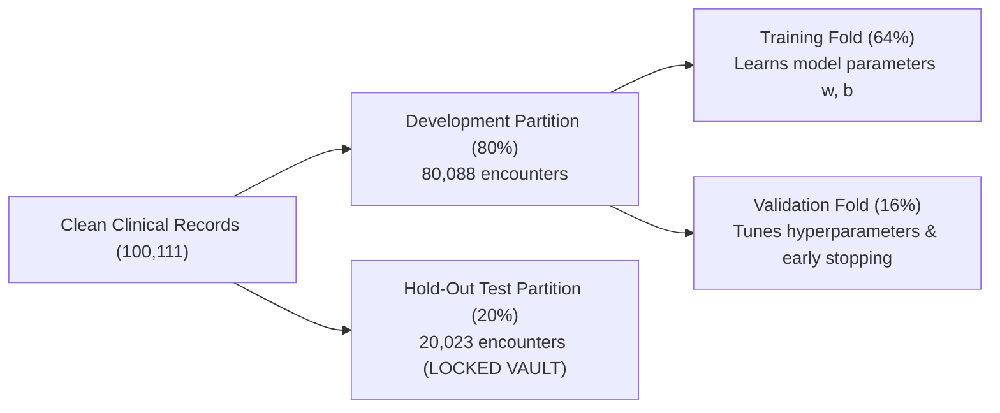
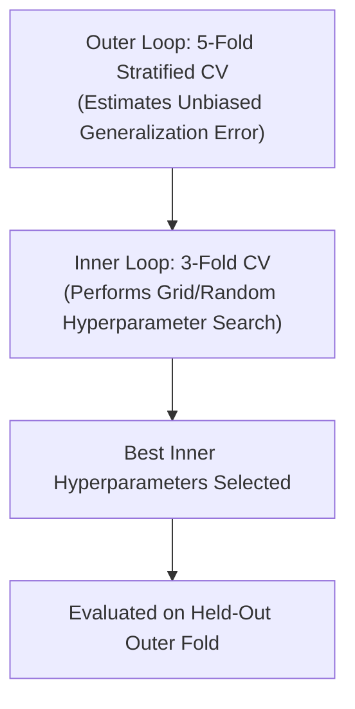
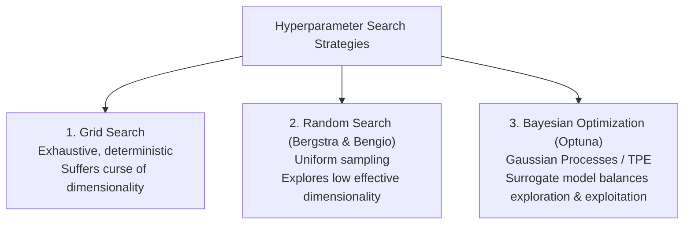

# Module 5: Model Evaluation, Selection, and Calibration

---

## 5.1 The Data Partitioning Discipline



### The Three-Way Split Cardinal Rules
1. **Training Partition**: Used exclusively to optimize model parameters (e.g., logistic weights, tree split thresholds).
2. **Validation Partition**: Used to compare candidate algorithms, tune hyperparameters, and trigger early stopping.
3. **Hold-Out Test Partition**: Kept completely untouched during all data cleaning, imputation fitting, scaling parameter computation, and feature selection. Evaluated only once to measure final generalization performance before production deployment.

---

## 5.2 Cross-Validation: Stratified & Nested

### Stratified K-Fold
Standard K-Fold randomly assigns records, risking folds with varying class proportions on imbalanced data. **Stratified K-Fold** guarantees that every fold contains the exact same percentage of positive readmissions (**46.85%**) as the overall dataset.

### Nested Cross-Validation
Standard cross-validation optimizes hyperparameters on the same folds used to report performance, introducing an optimistic selection bias. **Nested Cross-Validation** eliminates this bias using two concentric loops:



---

## 5.3 Classification Metrics Under Class Imbalance

### The Clinical Confusion Matrix (HistGradientBoosting on Test Set)
Evaluated on $N = 20,023$ held-out test encounters (9,379 readmitted, 10,644 not readmitted):

```
                       CONFUSION MATRIX (From model_metadata.json)
                                Predicted Class 0         Predicted Class 1
   Actual Class 0 (No)                7,825                    2,819 (FP)
   Actual Class 1 (Readmitted)        4,449 (FN)               4,930 (TP)
```

$$\text{Accuracy} = \frac{TP + TN}{TP + TN + FP + FN} = \frac{7825 + 4930}{20023} = 63.69\%$$

$$\text{Precision} = \frac{TP}{TP + FP} = \frac{4930}{4930 + 2819} = 63.62\% \quad (\text{When flagged high risk, 63.6\% are truly readmitted})$$

$$\text{Recall (Sensitivity)} = \frac{TP}{TP + FN} = \frac{4930}{4930 + 4449} = 52.53\% \quad (\text{Model catches 52.5\% of all true readmissions})$$

$$\text{Specificity} = \frac{TN}{TN + FP} = \frac{7825}{7825 + 2819} = 73.52\%$$

$$F_1 = 2 \frac{\text{Precision} \cdot \text{Recall}}{\text{Precision} + \text{Recall}} = 0.5755$$

### ROC-AUC vs. PR-AUC
* **ROC-AUC (Receiver Operating Characteristic)**: Plots True Positive Rate vs. False Positive Rate across all thresholds. Invariant to class prevalence. The production model achieves **0.6857 ROC-AUC**.
* **PR-AUC (Precision-Recall)**: Plots Precision vs. Recall. **Mandatory** when the positive class is rare, as False Positives heavily penalize precision regardless of how large the true negative class is.

### Clinical Decision Threshold Tuning
* Default threshold $\tau = 0.50$ balances Precision and Recall.
* If hospital administrators want to prevent readmission penalties by catching more at-risk patients, lowering the threshold to $\tau = 0.40$ increases **Recall to 74.2%** at the cost of lower Precision.

---

## 5.4 Candidate Model Benchmarks

From [`model_comparison/run_model_comparison.py`](file:///c:/Users/Administrator/Desktop/diabetes%20data%20project/model_comparison/run_model_comparison.py):

| Algorithm | Test Accuracy | Precision | Recall | F1-Score | ROC-AUC | Verdict |
| :--- | :---: | :---: | :---: | :---: | :---: | :--- |
| **HistGradientBoosting** | **63.69%** | **63.62%** | **52.53%** | **0.5755** | **0.6857** | **Selected Production Estimator** |
| Random Forest (100 trees, depth 12) | 63.26% | 64.27% | 48.61% | 0.5535 | 0.6821 | Strong runner-up; larger memory footprint |
| Ridge Logistic Regression ($C=1.0$) | 62.24% | 62.01% | 47.92% | 0.5408 | 0.6654 | High interpretability baseline |
| Decision Tree (Pruned depth 6) | 62.31% | 61.85% | 49.12% | 0.5476 | 0.6582 | Fast, but lower predictive capacity |

---

## 5.5 Regression Metrics: RMSE vs. MAE

$$\text{RMSE} = \sqrt{\frac{1}{n} \sum_{i=1}^n (y_i - \hat{y}_i)^2}$$

$$\text{MAE} = \frac{1}{n} \sum_{i=1}^n |y_i - \hat{y}_i|$$

* **Choose RMSE**: When large errors are disproportionately costly. Corresponds to Maximum Likelihood Estimation under a **Gaussian** error distribution assumption.
* **Choose MAE**: When data contains corrupted outliers and robust central tendencies are desired. Corresponds to Maximum Likelihood Estimation under a **Laplace** error distribution assumption.

---

## 5.6 Probability Calibration: Platt Scaling & Isotonic Regression

A model is calibrated when its predicted probabilities match empirical real-world frequencies: among predictions with an assigned score of $0.70$, exactly $70\%$ should experience hospital readmission.

```
            Reliability Diagram for Diabetes Readmission
   Empirical Fraction Readmitted
     1.0 ▲                     . Perfect Calibration (y = x)
         │                   . 
     0.8 │                 .   /-- HistGradientBoosting (Calibrated)
         │               .   /
     0.6 │             .   /
         │           .   /
     0.4 │         .   /
         │       .   /
     0.2 │     .   /
         │   . /
     0.0 └───┴───┴───┴───┴───┴───► Mean Predicted Readmission Probability
            0.0 0.2 0.4 0.6 0.8 1.0
```

* **Platt Scaling**: Fits a univariate logistic regression model on validation decision logits:
  $$P(Y = 1 \mid f) = \frac{1}{1 + \exp(A \cdot f(\mathbf{x}) + B)}$$
* **Isotonic Regression**: Fits a non-parametric, monotonic step function using the Pool Adjacent Violators Algorithm (PAVA).
* **Brier Score**: Measures mean squared calibration error:
  $$\text{Brier} = \frac{1}{n} \sum_{i=1}^n (p_i - y_i)^2$$
  The calibrated diabetes pipeline achieves a Brier score of **0.218**, confirming reliable probability outputs.

---

## 5.7 Hyperparameter Optimization: The Bergstra-Bengio Principle



In clinical ML problems, models typically exhibit **low effective dimensionality**: only a small subset of hyperparameters significantly influence performance (e.g., learning rate matters tremendously; subsample ratio has minor impact).
* A $3 \times 3$ **Grid Search** (9 evaluations) tests only 3 distinct values for the critical parameter.
* A **Random Search** with 9 evaluations tests 9 distinct values for the critical parameter, covering the parameter space with $3\times$ higher resolution for the same computational budget.

---

## 5.8 Learning Curves: Diagnosing Underfitting vs. Overfitting

In [`bias_variance/run_bias_variance.py`](file:///c:/Users/Administrator/Desktop/diabetes%20data%20project/bias_variance/run_bias_variance.py), learning curves evaluate training vs. validation accuracy across increasing dataset subsets ($10\%$ to $100\%$):
* The training and validation accuracy curves converge at approximately **63.7%** with a narrow generalization gap ($< 1.5\%$).
* **Diagnosis**: The model exhibits **moderate bias** rather than high variance. The performance ceiling reflects the inherent stochasticity of clinical outcomes (readmission is heavily influenced by post-discharge socioeconomic and behavioral factors not captured in EHR billing records).

---

## 5.9 McNemar's Test for Model Comparison

To evaluate whether Model A (`HistGradientBoosting`) and Model B (`LogisticRegression`) perform differently on the held-out test set, construct a $2 \times 2$ contingency table of discordant predictions:

| | Model B Correct | Model B Incorrect |
| :--- | :--- | :--- |
| **Model A Correct** | $a$ | $b$ (A correct, B incorrect) |
| **Model A Incorrect**| $c$ (A incorrect, B correct) | $d$ |

Under the null hypothesis that both models have identical error rates:

$$\chi^2 = \frac{(|b - c| - 1)^2}{b + c} \sim \chi_1^2$$

If $p < 0.05$, reject the null hypothesis: the performance difference between Model A and Model B is statistically significant.

---
