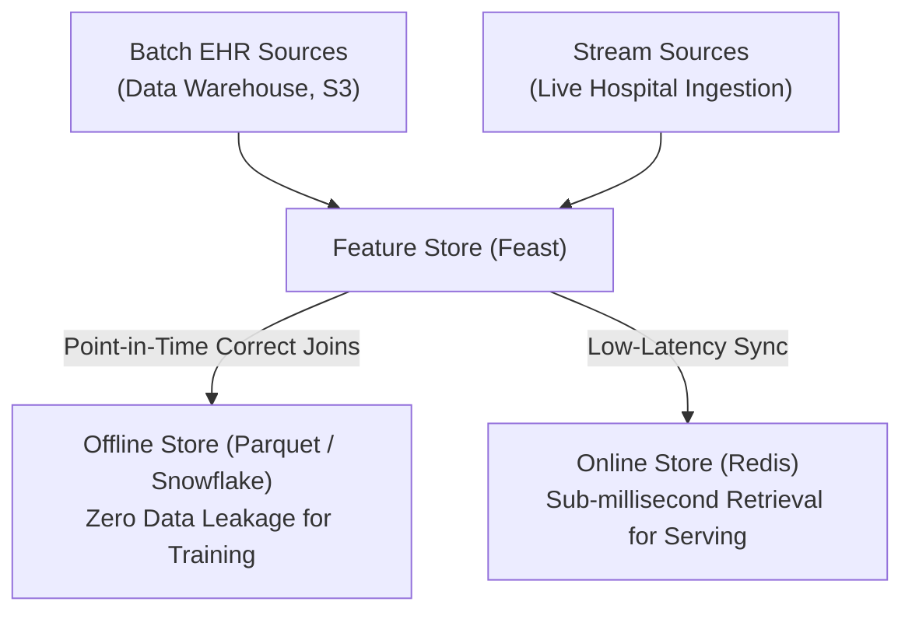
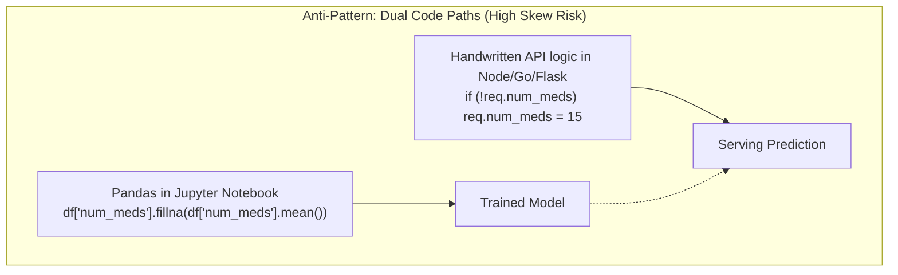
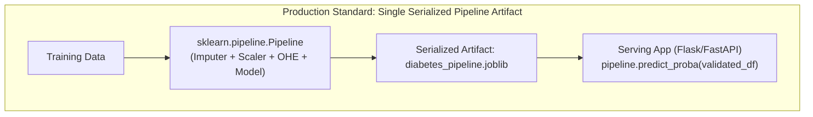
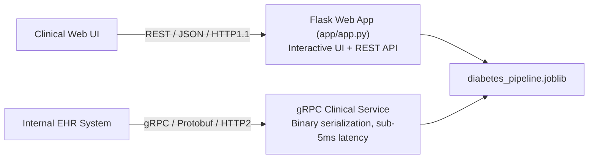
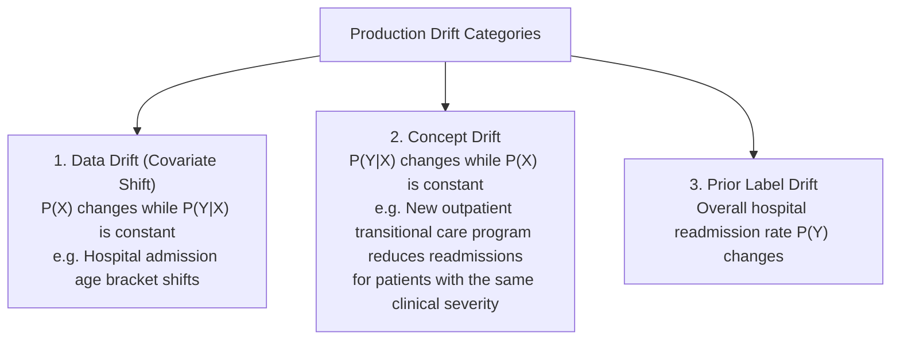
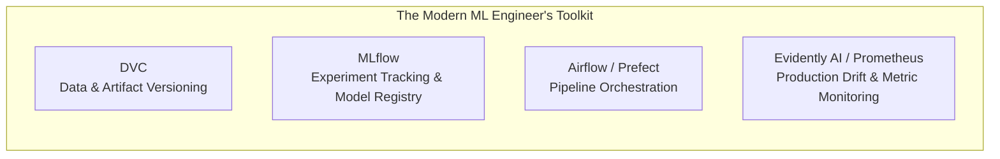

# Module 6: ML Engineering — From Notebook to Production

---

## 6.1 The Notebook-to-Production Gap

A Jupyter Notebook is an experimental scratchpad; it is not a production software artifact. Transitioning an ML model to a reliable production service requires software engineering discipline.

| Notebook Characteristic (Anti-Pattern) | Production Engineering Ritual |
| :--- | :--- |
| Non-linear, out-of-order execution states. | Deterministic execution pipelines managed via pure functions. |
| Global variable pollution across cells. | Pure, modular functions with strict type hinting (`pydantic`, `mypy`). |
| Ad-hoc hardcoded file paths and magic numbers. | Centralized configuration files ([`src/config.py`](file:///c:/Users/Administrator/Desktop/diabetes%20data%20project/src/config.py), environment variables). |
| Untracked transient dependencies. | Deterministic dependency locks (`requirements.txt`, `poetry.lock`, Docker images). |
| Zero automated testing. | Automated unit, integration, and API tests ([`tests/test_api.py`](file:///c:/Users/Administrator/Desktop/diabetes%20data%20project/tests/test_api.py), [`tests/test_pipeline.py`](file:///c:/Users/Administrator/Desktop/diabetes%20data%20project/tests/test_pipeline.py)). |

---

## 6.2 Feature Stores & Point-in-Time Correctness

In enterprise healthcare ML, feature engineering is decoupled from training and serving via a **Feature Store** (e.g., Feast):



### Point-in-Time Correctness ("Time Travel")
If a model is trained to predict whether a patient will be readmitted following a discharge on `2024-05-01`, but features are extracted using lab records updated through `2024-06-15`, future data leaks into training. A feature store enforces point-in-time joins: every encounter is joined strictly with feature values as they existed prior to the index discharge timestamp.

---

## 6.3 Training-Serving Skew

The most common failure in production machine learning is **Training-Serving Skew**: any discrepancy between training feature logic and serving feature logic.





### Mitigating Skew in DiabetesPredict
1. **Unified Pipeline**: [`src/preprocessing.py`](file:///c:/Users/Administrator/Desktop/diabetes%20data%20project/src/preprocessing.py) packages `ColumnTransformer` (standardization + one-hot encoding) and `HistGradientBoostingClassifier` into `models/diabetes_pipeline.joblib`.
2. **Schema Contracts**: [`src/predict.py`](file:///c:/Users/Administrator/Desktop/diabetes%20data%20project/src/predict.py) enforces numeric bounds and type casting before passing inputs to the pipeline.

---

## 6.4 Model Packaging: Pickle Pitfalls, ONNX, and Docker

### The Security & Fragility Risks of Pickle
Python's default serialization module (`pickle` / `joblib`) serializes Python bytecode instructions rather than just model weights:
1. **Arbitrary Code Execution**: Unpickling untrusted files can run arbitrary shellcode via `__reduce__` exploit vectors.
2. **Python Version Fragility**: A model pickled in Scikit-Learn `1.2.2` on Python `3.10` will frequently crash when unpickled in Scikit-Learn `1.5.0` on Python `3.11`.

### The Modern Alternative: ONNX (Open Neural Network Exchange)
ONNX represents computation as a language-agnostic directed computation graph:
* Serializes architecture and tensor weights into a standardized protobuf format.
* Executed via **ONNX Runtime** in C++, Go, Java, or C# without needing a Python interpreter.
* Delivers $2\times\text{--}5\times$ lower inference latency and zero Python runtime overhead.

```python
# Converting Scikit-Learn Pipeline to ONNX
from skl2onnx import convert_sklearn
from skl2onnx.common.data_types import FloatTensorType
import onnxruntime as ort

initial_type = [('float_input', FloatTensorType([None, 41]))]
onnx_model = convert_sklearn(pipeline, initial_types=initial_type)

with open("diabetes_model.onnx", "wb") as f:
    f.write(onnx_model.SerializeToString())

# Low-latency inference via ONNX Runtime
session = ort.InferenceSession("diabetes_model.onnx")
inputs = {session.get_inputs()[0].name: X_test[:1].astype(np.float32)}
onnx_preds = session.run(None, inputs)
```

### Production Containerization with Docker (CO6 Implementation)
To eliminate environment divergence ("it works on my machine") and ensure clinical reproducibility, the serving application is packaged into an isolated Docker container ([`Dockerfile`](file:///c:/Users/Administrator/Desktop/diabetes%20data%20project/Dockerfile), [`docker-compose.yml`](file:///c:/Users/Administrator/Desktop/diabetes%20data%20project/docker-compose.yml), and [`co6/run_co6_docker.py`](file:///c:/Users/Administrator/Desktop/diabetes%20data%20project/co6/run_co6_docker.py)):

1. **Lightweight Base Image**: Built on `python:3.11-slim` to minimize attack surface and reduce container image size.
2. **Clinical Security & HIPAA Hardening**: Executes under an unprivileged non-root user (`USER appuser`, UID 1000) under the Principle of Least Privilege.
3. **Layer Caching Optimization**: `requirements.txt` dependencies are installed before copying application code for rapid build caching.
4. **Context Minimization**: [`.dockerignore`](file:///c:/Users/Administrator/Desktop/diabetes%20data%20project/.dockerignore) excludes raw 101k datasets (`diabetic_data.csv`), bytecode, `.git`, and `.venv` to decrease context size by >95%.
5. **Continuous Health Probing**: Configured with Docker `HEALTHCHECK` probe pinging `GET http://localhost:5000/health`.
6. **Multi-Worker Production WSGI**: Served with `Gunicorn` (2 workers, 2 threads, 60s timeout) exposed on port 5000.

```bash
# Build the container image
docker build -t diabetes-predict-app:1.0.0 .

# Orchestrate service with Docker Compose
docker compose up --build -d

# Execute CO6 container audit runner
py co6/run_co6_docker.py
```

---

## 6.5 Serving Frameworks: Flask vs. FastAPI vs. gRPC



### Framework Comparison
* **Flask (Current Workspace Deployment)**: Synchronous, lightweight, renders Jinja2 clinical templates and serves `/api/predict` JSON endpoints.
* **FastAPI**: Asynchronous (ASGI), automatic OpenAPI/Swagger documentation, native Pydantic schema validation.
* **gRPC**: Binary serialization via Protocol Buffers over HTTP/2 multiplexed connections. Best for high-throughput inter-service hospital systems with sub-5ms latency budgets.

---

## 6.6 Production Monitoring: The Three Drift Classes

Once an ML system is deployed, clinical distributions drift over time:



### Population Stability Index (PSI)
$$\text{PSI} = \sum_{b=1}^B (P_{\text{prod}, b} - P_{\text{train}, b}) \times \ln\left(\frac{P_{\text{prod}, b}}{P_{\text{train}, b}}\right)$$

* $\text{PSI} < 0.10$: Distribution stable; no action needed.
* $0.10 \le \text{PSI} < 0.25$: Moderate drift; warning triggered.
* $\text{PSI} \ge 0.25$: Significant drift; trigger automated retraining of `models/diabetes_pipeline.joblib`.

### Kolmogorov-Smirnov (KS) Test
Non-parametric test comparing empirical cumulative distributions of continuous features:

$$D = \sup_x |F_{\text{prod}}(x) - F_{\text{train}}(x)|$$

---

## 6.7 Retraining Strategies & Automated Testing

### Retraining Approaches
* **Scheduled Retraining**: Batch retraining on a recurring calendar schedule (e.g., quarterly, aligned with hospital protocol updates).
* **Drift-Triggered Retraining**: Automatically launches a retraining workflow when PSI exceeds 0.25.
* **Online Continual Learning**: Incrementally updating weights sample-by-sample via SGD. (Rarely used in healthcare due to catastrophic forgetting and regulatory validation requirements).

### Automated CI/CD Testing Rituals
In [`tests/test_api.py`](file:///c:/Users/Administrator/Desktop/diabetes%20data%20project/tests/test_api.py), [`tests/test_pipeline.py`](file:///c:/Users/Administrator/Desktop/diabetes%20data%20project/tests/test_pipeline.py), [`tests/test_data.py`](file:///c:/Users/Administrator/Desktop/diabetes%20data%20project/tests/test_data.py), and [`tests/test_docker.py`](file:///c:/Users/Administrator/Desktop/diabetes%20data%20project/tests/test_docker.py):
1. **Data Hygiene Unit Tests**: Validate that deceased disposition IDs (11, 19, 20, 21) are strictly absent.
2. **Pipeline Tests**: Ensure `diabetes_pipeline.joblib` loads, accepts valid schemas, and outputs probability scores bounded in $[0, 1]$.
3. **API Integration Tests**: Ensure `GET /` returns status 200, `POST /api/predict` handles missing values gracefully, and inference latency meets SLAs.
4. **Container Infrastructure Tests**: Ensure Dockerfile least-privilege security (`USER appuser`), `.dockerignore` context hygiene, compose definitions, and `/health` probe endpoints return HTTP 200.

---

## 6.8 The MLOps Tooling Ecosystem



### Downstream Curriculum Progression
* **This Course (M1–M6)**: Classical ML, tabular EHR models, tree ensembles, convex optimization, probability calibration, Flask/FastAPI serving, and drift monitoring.
* **DLAC**: Deep learning for unstructured clinical signals (medical imaging, raw ICU waveforms).
* **GALE**: Generative clinical modeling (synthetic EHR data, diffusion models).
* **NLPL**: Biomedical NLP, clinical notes extraction, and LLM fine-tuning.
* **SDSR**: Multi-hospital federated learning, enterprise feature stores, and distributed Kubernetes orchestration.

---
